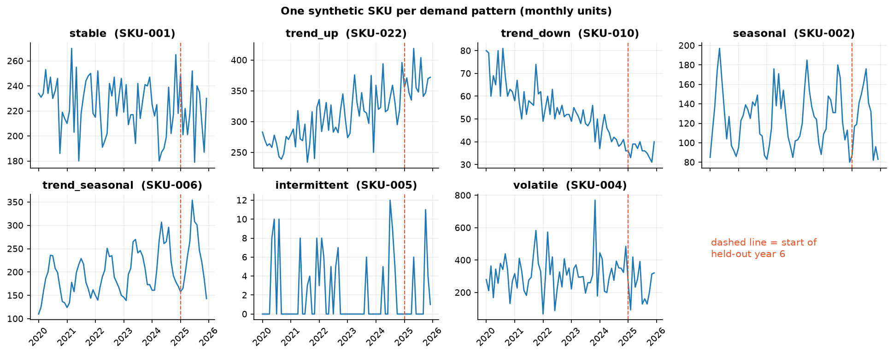
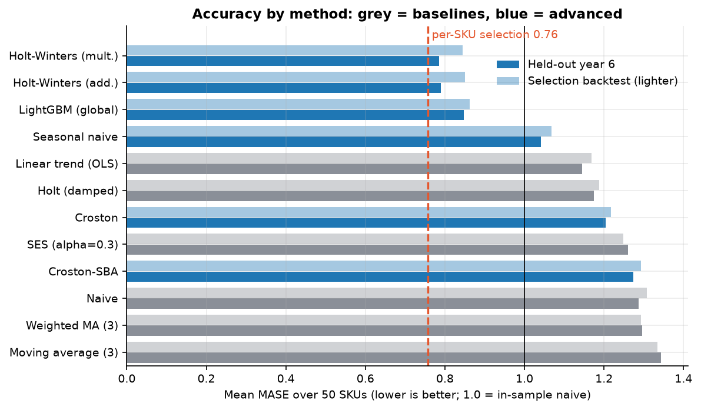
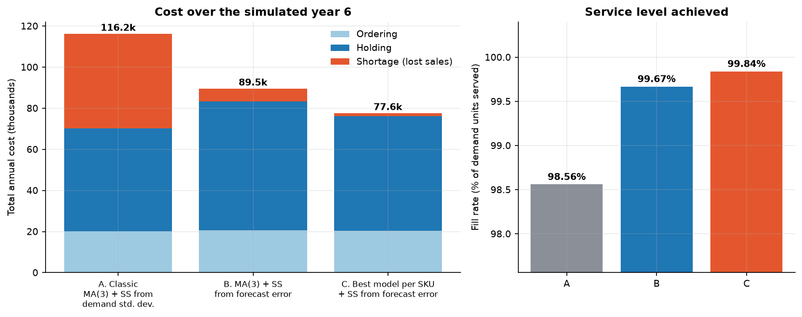

# Demand Forecasting and Inventory Policy for a 50-SKU Portfolio

*Inspired by a university Supply Chain & Operations Management assignment originally done in Excel; rebuilt independently in Python with synthetic data.*

A reproducible pipeline that forecasts monthly demand for 50 SKUs with baseline and advanced methods, selects the best method per SKU with a rolling-origin backtest, and then answers the question a planner actually cares about: **does a better forecast lower inventory cost at the same service level?** It is answered with a daily inventory simulation on a held-out year.

| | |
|---|---|
| Language / stack | Python 3.12, pandas, statsmodels, scikit-learn, LightGBM, matplotlib, pytest |
| Data | 100 % synthetic, seeded generator (50 SKUs x 72 months) |
| Tests | 32 pytest cases |
| Notebook | [`notebooks/demand_forecasting.ipynb`](notebooks/demand_forecasting.ipynb), executed, outputs saved |

## 1. Business problem

A distributor stocks 50 SKUs with very different demand: stable, trending, seasonal, volatile and slow-moving. Replenishment is driven by a reorder point (ROP) and order quantity (EOQ), both of which depend on the demand forecast and on a safety-stock buffer. Two questions:

1. Which forecasting method should each SKU use, and how much better is it than a spreadsheet-style moving average?
2. If the better forecast is plugged into the inventory policy, what happens to **total cost** (ordering + holding + lost sales) and **service level**?

## 2. Data (synthetic)

`src/scm_forecast/data.py` generates everything from a fixed seed (default 42): the same data is rebuilt on every run. No real or third-party data is used or included.

* 50 SKUs, 5 categories, **60 months of history + a held-out year 6** (months 61-72), used only for evaluation and simulation.
* Seven demand patterns with fixed counts: stable (8), trend up (7), trend down (3), seasonal (9), trend + seasonal (10), intermittent (7), volatile with promo spikes (6).
* Per-SKU unit cost and 12 monthly lead-time observations (mean and standard deviation in days).
* Demand-pattern classification (ADI / CV2, Syntetos-Boylan): 43 smooth, 7 intermittent.



## 3. Methods

| Group | Methods |
|---|---|
| Baselines (the family used in the Excel exercise) | Naive, moving average (3), weighted MA (3), SES (alpha 0.3), Holt (damped), linear trend (OLS) |
| Advanced | Seasonal naive, Holt-Winters additive / multiplicative (statsmodels), Croston and Croston-SBA, **global LightGBM** with lag/rolling features trained across SKUs |

**Evaluation (no look-ahead).**
* *Selection*: expanding-window rolling origin, 24 origins (months 36-59), horizons 1-3. The best method per SKU has the lowest mean MASE. Intermittent/lumpy SKUs may only choose level methods (naive, MA, WMA, SES, Croston, SBA).
* *Test*: selection is frozen, then all methods are scored on the untouched year 6 (12 rolling origins, horizons 1-3).
* Metrics: MAE, RMSE, sMAPE, MASE (scaled by in-sample naive MAE), WAPE. A unit test checks that changing future data does not change an earlier forecast.

**Inventory policy.** ABC (annual value, 80/15/5 %), XYZ (CV of monthly demand: X < 0.30, Y < 0.60), target cycle service level by ABC class (A 98 %, B 95 %, C 90 %).

* EOQ = sqrt(2DS/H)
* Classic safety stock: SS = z * sigma_d * sqrt(LT), with sigma_d the standard deviation of *demand*
* Forecast-error safety stock: SS = z * sqrt(LT/30 * sigma_e^2 + (d * sigma_LT)^2), with sigma_e the RMSE of one-step forecast errors
* ROP = d * LT + SS

**Simulation.** Daily (s, Q) policy over year 6 for each SKU. ROP and Q are refreshed monthly from the one-step-ahead forecast. Lost sales, random lead times, and identical demand/lead-time draws across policies. Assumptions (all adjustable in `CostParams`): order cost 40, holding 25 % of unit cost per year, a lost sale costs 50 % of unit cost.

Three policies are compared:
* **A. Classic**: MA(3) forecast + safety stock from demand standard deviation (the textbook approach)
* **B.** MA(3) forecast + safety stock from forecast error (isolates the buffer-sizing effect)
* **C.** Best model per SKU + safety stock from forecast error

## 4. Results (seed 42, all numbers from `scripts/run_pipeline.py`)

### 4.1 Forecast accuracy on the held-out year (mean over 50 SKUs, lower is better)

| Method | MASE | RMSE | WAPE % |
|---|---|---|---|
| Moving average (3) | 1.344 | 37.6 | 32.6 |
| SES (alpha 0.3) | 1.260 | 35.2 | 31.5 |
| Linear trend (best baseline) | 1.144 | 32.4 | 29.8 |
| Holt-Winters (additive) | 0.790 | 24.4 | 27.6 |
| LightGBM (global) | 0.848 | 25.4 | 27.5 |
| **Per-SKU selection (frozen before year 6)** | **0.757** | **23.0** | **25.8** |

* Per-SKU selection cuts MASE by **43.7 %** versus MA(3) and **33.8 %** versus the best baseline, and beats MA(3) on 84 % of SKUs. The selection-phase advantage (ratio 0.567) is about the same as on held-out data (0.563), so there is no visible selection optimism at portfolio level.
* The gain is concentrated where the structure is: MASE falls from 1.87 to 0.48 on seasonal SKUs and from 2.23 to 0.77 on trend + seasonal SKUs. On stable, volatile and trend-up SKUs the gain is 8-12 %, and on **intermittent SKUs there is none** (0.88 for MA(3), 0.89 selected; Croston and SES score 0.87-0.88): all methods sit within a narrow band.
* Spreadsheet-style protocol (one 12-month forecast from the end of year 5): MAD 31.7 (MA3), 29.0 (SES), 26.6 (linear trend), 19.7 (Holt-Winters), 18.8 (selection).



### 4.2 Inventory simulation (year 6, 50 SKUs, identical demand and lead-time draws)

| Policy | Total cost | Ordering | Holding | Lost sales | Fill rate | Avg. inventory value |
|---|---|---|---|---|---|---|
| A. Classic (MA3 + demand-sd SS) | 116,203 | 20,200 | 49,947 | 46,056 | 98.56 % | 199,786 |
| B. MA3 + forecast-error SS | 89,550 | 20,640 | 62,731 | 6,179 | 99.67 % | 250,923 |
| **C. Best model + forecast-error SS** | **77,616** | 20,320 | 55,907 | 1,389 | **99.84 %** | 223,627 |

* **C vs A: -33.2 % total cost**, lost units 1,462 -> 163. **C vs B: -13.3 % cost with 10.9 % less inventory** at a higher fill rate: the better forecast shrinks the error and therefore the buffer needed.
* Sizing safety stock on forecast error alone (B vs A) is worth -22.9 %. Error-based buffers are *larger* than textbook ones because a 3-month average lags seasonal and trending demand; policy A looks lean but is under-protected.
* The saving is concentrated in trend-up (-49 %), trend + seasonal (-38 %) and seasonal (-25 %) SKUs. On stable and trend-down SKUs policy A is about as cheap or slightly cheaper.



### 4.3 Robustness: six independent synthetic datasets (seeds 42, 1-5)

| | mean | range |
|---|---|---|
| MASE reduction, selection vs MA(3) | 40.1 % | 37.1 % to 43.7 % |
| Cost reduction C vs A | 23.1 % | 15.1 % to 33.2 % |
| Cost reduction C vs B | 10.9 % | 4.2 % to 16.6 % |

Seed 42, used for the headline tables above, is the **most favourable** of the six for C vs A. The six-seed means are the fairer summary: roughly **a fifth to a quarter lower cost** and a higher fill rate (99.8 % vs 98.8 % average). Every seed favours C.

### 4.4 Sensitivity to the lost-sale penalty

The cost ranking depends on an assumption. Re-costing the same simulation: policy C is cheaper than A once a lost sale costs more than about **7 % of the unit cost**. With no lost-sale penalty at all, A is the cheapest (70,147 vs 76,227) because it simply holds less stock. See `reports/figures/11_shortage_sensitivity.png`.

## 5. Business recommendations

1. **Segment, then choose the method.** Use Holt-Winters (or a global LightGBM) for seasonal and trend-seasonal SKUs, where the accuracy gain is largest. Keep simple averages or Croston for stable and slow-moving SKUs, where nothing beats them by much.
2. **Size safety stock on forecast error, not on raw demand variability**, and include lead-time variability. This is the larger single lever in the simulation (B vs A) and it reduces lost sales sharply.
3. **Re-estimate the error continuously** (rolling RMSE per SKU) so a model upgrade automatically lowers the buffer; the better model in policy C cut inventory by about 11 % versus B at equal or better service.
4. **Start with class A SKUs** (11 SKUs, 80 % of annual value): the best accuracy gains on high-value SKUs pay back first.
5. **Do not expect gains on intermittent SKUs** from model tuning; manage them with order policy (min/max, consolidation) rather than forecasting.

## 6. Limitations

* **Synthetic data.** Patterns are cleaner than real demand: no promotions in the history, no stock-out censoring, no supplier disruptions. Absolute numbers will not transfer; the workflow does.
* Cost parameters and service targets are assumptions, and the ranking depends on the lost-sale penalty (section 4.4).
* Monthly demand is split across days at random; real intra-month demand has structure. Single-echelon, lost-sales, no MOQ or capacity limits, one simulated year per dataset.
* z-score safety stock assumes roughly normal errors, a poor fit for low-volume intermittent items.
* **Researcher degrees of freedom.** After a first run, intermittent SKUs were restricted to level methods because the unrestricted selection picked seasonal models for mostly-zero series. The change moved the seed-42 selection MASE from 0.769 to 0.757 (mean across six seeds 0.789 to 0.782). Thresholds for ABC/XYZ, the 24-origin window and the policy parameters were fixed by judgement, not tuned.
* Small sample per pattern (3 to 10 SKUs), so pattern-level conclusions are indicative.

## 7. Repository layout

```
src/scm_forecast/   data.py (generator) · metrics.py · models.py · ml.py (LightGBM)
                    backtest.py · inventory.py · simulation.py · pipeline.py · plots.py
scripts/            run_pipeline.py · robustness.py
notebooks/          demand_forecasting.ipynb  (executed, outputs saved)
tests/              32 pytest cases
data/synthetic/     generated CSVs (demand, SKU master, lead times)
reports/results/    result tables (CSV)      reports/figures/   PNG figures
```

## 8. How to run

```bash
python -m venv .venv
source .venv/bin/activate          # Windows: .venv\Scripts\activate
pip install -r requirements.txt
pip install -e .

pytest                                   # 32 tests, about 30 s
python scripts/run_pipeline.py --no-cache   # full run, about 1.5 min on a 20-core machine
python scripts/robustness.py             # optional: 6 datasets, several minutes
jupyter nbconvert --to notebook --execute --inplace notebooks/demand_forecasting.ipynb
```

The run is deterministic for a given seed and environment (pinned versions in `requirements.txt`).

## 9. AI assistance disclosure

This repository was built with substantial assistance from an AI coding assistant (Claude, by Anthropic, used through Claude Code). The assistant wrote the code, tests, notebook and documentation from a brief written by the repository owner, and ran the experiments; every number in this README was produced by running the code in this repository. The owner remains responsible for the content. The synthetic data generator is original and no data, questions or files supplied by the course were copied into the repository.

## 10. Licence

MIT, see [LICENSE](LICENSE).
